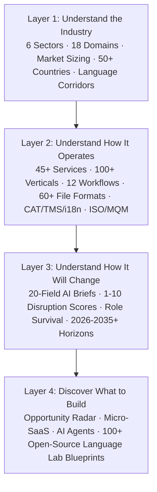

> **Mandate Reference:** `ATLAS_MASTER_PROMPT.md` — Part 1, Part 3, Part 30, Part 32 (Deliverable 1), and Mandatory Addendum C.

---

## 1. The Four-Layer Architecture of the Language Economy

Unlike traditional overviews that treat "translation" as an isolated service, this Atlas maps the **entire Global Language Industry and Language Economy** across four interlocking analytical layers:

---

## 2. The 6-Sector Language Industry Ecosystem (Addendum C.1)

The global language economy comprises six distinct yet deeply interconnected sectors. While traditional market research firms (Nimdzi, CSA Research, Slator) primarily track **Sector 1 (Language Services)** and **Sector 2 (Language Technology)** (~$70B–$75B+ combined in 2024–2025), the wider 6-sector ecosystem exceeds **$200B+ globally** when digital/institutional language education, multilingual AI data infrastructure, audiovisual content production, and public linguistic infrastructure are included.

| Sector # | Ecosystem Sector | Core Activities & Subsegments | Representative Organizations & Players | Estimated Economic Scale & Nature |
| :--- | :--- | :--- | :--- | :--- |
| **Sector 1** | **Language Services** | Written translation, localization, transcreation, editing/revision, MTPE, consecutive/simultaneous/remote interpreting (OPI/VRI/RSI), ASL/sign language, transcription, subtitling, dubbing, DTP, linguistic validation, certified/sworn translation | TransPerfect, LanguageLine Solutions, RWS, Lionbridge, Keywords Studios, Welocalize, IYUNO, Acolad | **$65B–$73B+** (Verified 2024–2025 LSP market sizing via Nimdzi 100 / CSA / Slator; services-dominated) |
| **Sector 2** | **Language Technology** | CAT tools, Cloud TMS, Translation Memory (TM), Termbases (TB), Neural MT, LLM translation routers, speech-to-text (ASR), text-to-speech (TTS), voice cloning, localization engineering, automated LQA, BMS/ERP | RWS (Trados/Language Weaver), Phrase, Smartling, Lokalise, Crowdin, memoQ, DeepL, OOONA, XTRF, Plunet | **$3.5B–$6B+** direct localization/MT SaaS (expanding rapidly as LLM inference and voice AI APIs merge into enterprise stacks) |
| **Sector 3** | **Language Education & Assessment** | K-12/university language instruction, consumer apps, corporate language training, live tutoring marketplaces, high-stakes proficiency testing (IELTS, TOEFL, JLPT, CEFR, Duolingo English Test), test localization | Duolingo, Pearson, ETS, IDP/British Council, Preply, iTalki, Berlitz, EF Education First, Babbel | **$60B–$100B+** global offline + digital language learning & assessment economy |
| **Sector 4** | **Language Data & AI Infrastructure** | Multilingual parallel corpora, SFT/RLHF preference annotation, speech collection, accent/dialect datasets, red-teaming, cultural alignment benchmarks, synthetic multilingual data, open corpora | Scale AI, Appen, LXT, Centific, RWS TrainAI, TransPerfect DataForce, TAUS, Hugging Face, ELRA, AI4Bharat | **$4B–$8B+** dedicated multilingual AI training data & evaluation market (fastest-growing B2B segment) |
| **Sector 5** | **Language Content & Media** | Global OTT streaming localization, theatrical dubbing, multi-language YouTube creator networks, translated book publishing, international news syndication, multilingual marketing production | Netflix, Disney, Amazon MGM, YouTube multilingual creators, IYUNO, Zoo Digital, Pixelogic, global publishers | Embedded across **$100B+** global media distribution (direct AVT outsourcing ~$4B–$5B+) |
| **Sector 6** | **Language Research & Public Infrastructure** | Academic computational linguistics, national language academies, government translation bureaus, EU Directorate-General for Translation (DGT), court/healthcare language-access mandates, indigenous preservation | EU DGT, UN DGACM, UNESCO, CLARIN, META-NET, Unicode Consortium, W3C, NIST, national ministries | Public-sector funded ($3B–$5B+ institutional budgets across EU, UN, US Federal/State, Canada, India Bhashini) |

---

## 3. The 18 Mandatory Domains (Addendum C.2)

Every topic across the 20 Volumes is mapped to one or more of the **18 Mandatory Domains**:

1. **Domain 01 — Language Services:** All 45+ written, spoken, signed, and audiovisual services (Part 3A).
2. **Domain 02 — Language Technology:** CAT, TMS, TM, TB, NMT, LLM orchestration, speech tech, and BMS/ERP (Part 8 & Part 18).
3. **Domain 03 — Language Education & Assessment:** Consumer apps, corporate training, CEFR/JLPT/IELTS/TOEFL, AI tutors, and psychometric test localization (Part 22).
4. **Domain 04 — Language Data & AI Infrastructure:** Parallel corpora, RLHF, speech data, synthetic data, evaluation benchmarks, and sovereign language models (Part 19 & Addendum C).
5. **Domain 05 — Language Content, Publishing & Media:** Subtitling, lip-sync dubbing, voiceover, SDH, audio description, literary translation, and creator media (Part 11).
6. **Domain 06 — Linguistic Research & Public Language Infrastructure:** CLARIN, ELRA, META-NET, government language portals, dictionaries, and standards bodies (Addendum D).
7. **Domain 07 — Enterprise Globalization & Internationalization (i18n):** Unicode, UTF-8/16, BCP 47, CLDR, ICU MessageFormat, BiDi/RTL, UI layout, and buyer-side org design (Part 9 & Addendum C.3).
8. **Domain 08 — Language Procurement & Global Supply Chains:** Multi-tier cascading (Enterprise → Mega-LSP → Regional MLV/SLV → Freelancer), RFPs, rate cards, and vendor portals (Part 15 & Addendum C.5).
9. **Domain 09 — Linguistics & Computational Linguistics:** Phonetics, morphology, syntax, semantics, pragmatics, sociolinguistics, corpus linguistics, and terminology science (Addendum C.4 & D.2).
10. **Domain 10 — Language Economics & Language-Pair Economics:** 4-perspective country matrix (Demand, Supply, Consumption, Infrastructure) and corridor pricing/directionality (Part 4, Part 5 & Addendum C.6).
11. **Domain 11 — Language Policy, Geopolitics & Language Rights:** Official language laws (Bill 96 Quebec, EU 24-language parity, US Title VI/ACA 1557, India Eighth Schedule) and digital sovereignty.
12. **Domain 12 — Accessibility & Inclusive Multilingual Communication:** WCAG, European Accessibility Act (EAA), SDH, audio description, Easy Read / Plain Language, and sign language interpreting.
13. **Domain 13 — Intellectual Property, Licensing & Liability:** Copyright of derivatives, TM ownership disputes, AI voice cloning consent (SAG-AFTRA), and professional indemnity (Part 21).
14. **Domain 14 — Cross-Border Taxation & Financial Operations:** Global freelancer payouts, VAT/GST reverse charge, withholding taxes, currency hedging, and 60–90 day DSO working capital.
15. **Domain 15 — Industry Investment, Acquisitions & Consolidation:** Private equity roll-ups (EQT/Keywords, RWS/SDL, Teleperformance/LanguageLine), VC funding (DeepL, ElevenLabs), and valuation multiples.
16. **Domain 16 — Open-Source Language Infrastructure:** OmegaT, Okapi Framework, MateCat, OpusMT, Hugging Face datasets, Whisper, ICU, and the 100-project Open-Source Lab (Part 27).
17. **Domain 17 — Global Multilingual Content Operations & Internet Ecosystems:** Local search engines (Naver, Baidu, Yahoo! Japan), super-apps (WeChat, LINE), `hreflang` SEO, and regional social norms.
18. **Domain 18 — Language Preservation & Minority-Language Ecosystems:** Endangered/indigenous language documentation, orthographic standardization, and low-resource community AI (UNESCO IDIL).

---

## 4. Master Table of Contents — The 20 Volumes (Part 30)

### Volume 1 — The Language Industry: From Zero to Expert
- **Ch 1.1:** Definition, Scope, Purpose & The 6-Sector Language Economy (`/01-volumes/ch01-definition-scope-purpose/`)
- **Ch 1.2:** Complete History — From Ancient Scribes & Nuremberg Booths to CAT Tools, NMT & Agentic AI (`/01-volumes/ch02-history-evolution/`)
- **Ch 1.3:** The Complete Industry Value Chain & Supply Cascade (`/01-volumes/ch03-value-chain/`)
- **Ch 1.4:** Major Participants — Buyers, Mega-LSPs, Boutique Agencies, Tech Vendors & Linguists (`/01-volumes/ch04-major-participants/`)
- **Ch 1.5:** Master Taxonomy of Services, Segments & 100+ Verticals (`/01-volumes/ch05-master-taxonomy/`)
- **Ch 1.6:** The Business of Language — How the 12 Business Models Make Money (`/01-volumes/ch06-how-industry-makes-money/`)
- **Ch 1.7:** Anatomy of a Localization Project — From Initial Client Email to Final Payment (`/01-volumes/ch07-anatomy-of-a-project/`)

### Volume 2 — The Global Language Industry Market
- **Ch 2.1:** Market Sizing Reconciliation — Why Nimdzi, Slator, CSA & Wall Street Estimates Differ
- **Ch 2.2:** The 4-Perspective Geographic Framework (Demand, Supply, Consumption, Infrastructure)
- **Ch 2.3:** North America & Western Europe Country Profiles (USA, Canada, UK, Ireland, Germany, France, Spain, Italy, Nordics, Benelux, DACH)
- **Ch 2.4:** Central/Eastern Europe, Russia, Ukraine & Turkey Delivery & Buyer Markets
- **Ch 2.5:** East Asia & Southeast Asia Profiles (Japan, China, South Korea, Taiwan, Singapore, India, Philippines, Indonesia, Vietnam, Thailand)
- **Ch 2.6:** Latin America, Middle East & Africa Profiles (Brazil, Mexico, Argentina, Colombia, UAE, Saudi Arabia, Egypt, South Africa)
- **Ch 2.7:** Global Country Rankings & Geographic Delivery Models (Onshore, Nearshore, Offshore, Global Delivery Centers)

### Volume 3 — Languages, Language Pairs & Language Economics
- **Ch 3.1:** Linguistic Foundations for Industry Practitioners (Phonetics, Morphology, Syntax, Pragmatics, Sociolinguistics, Terminology Science)
- **Ch 3.2:** Macro-Language Economics — Speakers vs. Internet Users vs. GDP vs. Willingness to Pay
- **Ch 3.3:** Resource Tiers — High, Medium, Low-Resource, Indigenous, Creoles & Sign Languages
- **Ch 3.4:** Major Commercial Corridors Part 1 — `EN <-> JA`, `EN <-> ZH`, `EN <-> KO` (CJK Deep Dive)
- **Ch 3.5:** Major Commercial Corridors Part 2 — `EN <-> DE`, `EN <-> FR`, `EN <-> ES`, `EN <-> PT-BR`, `EN <-> PL`
- **Ch 3.6:** High-Growth Corridors Part 3 — `EN <-> AR`, `EN <-> HI` & Indic, `EN <-> ID/TH/VI` & Non-English Direct Corridors (`JA <-> KO`, `ZH <-> JA`)

### Volume 4 — Core Language Services (45+ Services × 20-Point Template)
- **Ch 4.1:** Written Translation, Editing, Revision, Proofreading & MTPE
- **Ch 4.2:** Transcreation, Multilingual Copywriting, Adaptation & Cultural Consulting
- **Ch 4.3:** Localization, Internationalization (i18n) & Globalization (GILT) Services
- **Ch 4.4:** Spoken & Signed Interpretation (Simultaneous, Consecutive, Whispered, OPI, VRI, RSI, Conference, Court, Medical, Community, Sign Language)
- **Ch 4.5:** Audiovisual & Accessibility Services (Transcription, Subtitling, Captioning/SDH, Dubbing, Voiceover, Audio Description)
- **Ch 4.6:** Specialist & Regulated Services (Localization DTP, Terminology Management, Linguistic Validation, Certified/Sworn/Notarized Translation, Language Assessment)

### Volume 5 — Every Localization Vertical (100 Verticals × 22-Point Template)
- **Ch 5.1:** Software, Website, Mobile App & SaaS Localization (Verticals 1–4)
- **Ch 5.2:** Video Game Localization — AAA, Indie, Console, Mobile & Esports (Verticals 5–9, 78)
- **Ch 5.3:** Film, TV, OTT Streaming, YouTube & Social Media Localization (Verticals 10–15)
- **Ch 5.4:** Advertising, Marketing, SEO, SEM, Influencer & PR Localization (Verticals 16–21)
- **Ch 5.5:** E-Commerce, Retail, Product, Packaging, Luxury, Fashion & Beauty (Verticals 22–25, 73–76)
- **Ch 5.6:** Automotive, Manufacturing, Industrial, Technical Docs, Aviation, Maritime & Energy (Verticals 26–35)
- **Ch 5.7:** Medical, Healthcare, Pharma, Clinical Trials, MedTech & Patient Content (Verticals 36–42)
- **Ch 5.8:** Legal, Law Firms, Litigation, Contracts, Patents, Immigration & Government (Verticals 43–50)
- **Ch 5.9:** Financial, Banking, Fintech, Insurance, Investment, Accounting & Tax (Verticals 51–57)
- **Ch 5.10:** Education, E-Learning, LMS, Academic, Publishing, Literary & News/Journalism (Verticals 58–67)
- **Ch 5.11:** Travel, Hospitality, Food, Sports, Religious, NGO/Humanitarian, Science, Sustainability & HR (Verticals 68–72, 77, 79–88)
- **Ch 5.12:** Customer Support, Conversational AI, LLM Datasets, AI Safety, Accessibility & Multilingual UX Research (Verticals 89–100)

### Volume 6 — The Entire Production Process (12 Core Workflows)
- **Ch 6.1:** Standard Document Translation & Localization Workflows (Workflows A & B)
- **Ch 6.2:** Software, Website & Game Localization Workflows (Workflows C, D & E)
- **Ch 6.3:** Media, Marketing & Multilingual DTP Workflows (Workflows F, I & J)
- **Ch 6.4:** Regulated Clinical, Legal & Live Interpretation Workflows (Workflows G, H & K)
- **Ch 6.5:** AI-Native & Agentic Localization Workflows (Workflow L)

### Volume 7 — The Complete Localization Software Ecosystem
- **Ch 7.1:** CAT Tools Deep Comparison (Trados Studio, memoQ, Phrase, Wordfast, OmegaT, MateCat, Across)
- **Ch 7.2:** Cloud TMS Platforms (Smartling, Phrase, Lokalise, Crowdin, XTM, Transifex, Wordbee, RWS)
- **Ch 7.3:** Translation Memory (TM) & Terminology Management Systems
- **Ch 7.4:** Neural Machine Translation (NMT) & Frontier AI Translation Engines
- **Ch 7.5:** DTP, Media/AVT, Automated QA, Interpreting, AI Data Annotation & Business Management Systems (Plunet, XTRF, Protemos)

### Volume 8 — The Complete File Format Encyclopedia (60+ Formats × 17-Point Spec)
- **Ch 8.1:** Format Taxonomy & Compatibility Matrix (Source, Exchange, Bilingual, Native, Delivery, Compiled)
- **Ch 8.2:** Translation Exchange Formats (`XLIFF 1.2/2.1`, `TMX`, `TBX`, `SDLXLIFF`, `MQXLIFF`, `MXLIFF`, `TXLF`, `TTX`)
- **Ch 8.3:** Software & Web Formats (`JSON`, `ARB`, `XML`, `YAML`, `PO/MO/POT`, `RESX/RESW`, `STRINGS/STRINGSDICT`, `PROPERTIES`, `HTML`, `MDX`, `Liquid`)
- **Ch 8.4:** Subtitles, Audio & Video Formats (`SRT`, `VTT`, `ASS/SSA`, `TTML/IMSC1`, `STL`, `SCC`, `WAV`, `FLAC`, `OPUS`, `MP4`, `MOV`, `MXF`)
- **Ch 8.5:** DTP, Technical Docs, Office & AI Data Formats (`INDD`, `IDML`, `MIF/FM`, `AI/PSD/SVG`, `DITA/DITAMAP`, `DOCX/PPTX/XLSX`, `PDF`, `JSONL`, `Parquet`)

### Volume 9 — Internationalization (i18n) & The Language Technology Stack
- **Ch 9.1:** Character Encoding, Unicode, UTF-8/UTF-16, Grapheme Clusters, Normalization (NFC/NFD) & Font Rendering
- **Ch 9.2:** Locales, BCP 47 Tags, CLDR, ICU MessageFormat, Plurals, Gender, Date/Time/Currency & Collation
- **Ch 9.3:** Bidirectional (BiDi) Text Architecture, RTL Layout Mirroring, CJK Vertical Text, Expansion & Line Breaking
- **Ch 9.4:** The 8 Reference Technology Stacks (LSP, Enterprise, AI Startup, Freelancer, Media, Clinical, Software, Data)

### Volume 10 — Quality, Standards, Certification & Compliance
- **Ch 10.1:** The 10 Dimensions of Quality (Linguistic, Functional, Technical, Cultural, UX, AI, Accessibility, Regulatory)
- **Ch 10.2:** ISO & ASTM Standards Deep Dive (`ISO 17100`, `ISO 18587`, `ISO 5060`, `ISO 9001`, `ISO 27001`, `ISO 13485`, `ASTM F2575/F3614`)
- **Ch 10.3:** Analytic Quality Frameworks — MQM, TAUS DQF, Error Typologies, Sampling & Reviewer Calibration
- **Ch 10.4:** Automated Quality Estimation (MTQE, COMET, MetricX, LLM-as-a-Judge)

### Volume 11 — Media Localization: Complete Deep Dive
- **Ch 11.1:** Subtitling, Spotting, CPS/WPM Reading Speeds, Shot Changes & Pivot Templates
- **Ch 11.2:** Lip-Sync Dubbing, UN-Style Voiceover, Script Adaptation, Voice Casting, ADR Directing & Mixing
- **Ch 11.3:** Media Accessibility — Closed Captions, SDH, Audio Description (AD) & Live Broadcast Subtitling
- **Ch 11.4:** OTT Streaming Technical Specifications (Netflix Timed Text Style Guides, Disney, Amazon, IMF Packaging, YouTube Multi-Audio)

### Volume 12 — Regulated Industries: Clinical, Medical, Pharma, Legal & Finance
- **Ch 12.1:** Clinical Trials, eCOA/ePRO & The Complete ISPOR Linguistic Validation Protocol
- **Ch 12.2:** Medical Devices (EU MDR/IVDR, ISO 13485), Regulatory Submissions (FDA/EMA/PMDA eCTD) & Pharmacovigilance
- **Ch 12.3:** Legal Localization Handbook — Common vs. Civil Law, Contracts, Litigation/e-Discovery & IP/Patents (WIPO/PCT)
- **Ch 12.4:** Official Document Authentication — Certified, Sworn, Notarized Translations & Hague Apostille Mechanics

### Volume 13 — Localization Business Operations, Buyers & Supply Chain
- **Ch 13.1:** Inside an LSP — All 20 Departments, KPIs, Daily Operations & BMS Automation
- **Ch 13.2:** Buyer-Side Enterprise Localization Departments — Org Charts, Budget Ownership, RFPs & ROI Metrics
- **Ch 13.3:** Global Supply Chain, Vendor Management, Freelancer Onboarding & Value Distribution
- **Ch 13.4:** Sales, Client Acquisition, RFPs/Tenders, Account Management & Industry M&A Consolidation

### Volume 14 — Pricing, Finance & Unit Economics
- **Ch 14.1:** Commercial Pricing Models — Per-Word, Character, Hour, Minute, Page, TM Fuzzy Match Grids & MTPE Discounts
- **Ch 14.2:** LSP & Enterprise Unit Economics — Gross Margin, Contribution Margin, Utilization, DSO & Cross-Border Taxation
- **Ch 14.3:** Worked Financial Simulations — Profitable vs. Unprofitable Localization Projects Across 12 Business Models

### Volume 15 — AI, Multilingual Data & The Future Tech Stack
- **Ch 15.1:** 24 Real-World AI Use Cases in the Language Industry — Commercial Reality vs. Hype
- **Ch 15.2:** Agentic Localization Architectures — RAG over TM/TB, Dynamic Model Routing, Automated QE & HITL Loops
- **Ch 15.3:** Multilingual AI Data Infrastructure — SFT, RLHF, Red-Teaming, Speech Corpora & Synthetic Data Economics

### Volume 16 — The Complete Career Map & Education Ecosystem
- **Ch 16.1:** All 25 Language Industry Career Profiles — Skills, Tools, Compensation & AI Survival Analysis
- **Ch 16.2:** The Global Language Education & Assessment Industry — Business Models, CEFR/IELTS/JLPT & AI Tutors
- **Ch 16.3:** Complete Zero-to-Expert Curriculum (30-Day, 90-Day, 6-Month & 12-Month Learning System)

### Volume 17 — Industry Regulations, Ethics, IP & Risk
- **Ch 17.1:** Data Privacy, Confidentiality, GDPR, HIPAA, Data Residency & Enterprise AI Security
- **Ch 17.2:** Intellectual Property — Translation Copyright, TM Ownership, Voice Rights & AI Voice Cloning Consent
- **Ch 17.3:** Language Policy, Geopolitics, Indigenous Language Rights & Algorithmic Bias

### Volume 18 — Industry Failure Modes & 30 End-to-End Case Studies
- **Ch 18.1:** The 25 Localization Failure Modes — Root Causes, Detection, Prevention & Recovery
- **Ch 18.2:** Case Studies 1–15 — SaaS Entering Japan, Mobile Game in Brazil, Clinical Trial in India, OTT 100-Hour Slate & More
- **Ch 18.3:** Case Studies 16–30 — EU MDR MedTech, Saudi E-Commerce, YouTube 10-Language Creator, Building a Loc Dept from Scratch & More

### Volume 19 — The Industry Opportunity Radar & Open-Source Lab
- **Ch 19.1:** High-Conviction Startups, Micro-SaaS, AI Agents & Vertical Platforms (Full 18-Point Opportunity Evaluations)
- **Ch 19.2:** The Open-Source Language Industry Lab — 100 Practical Solo-Buildable Project Specs Across 15 Categories

### Volume 20 — The Future of the Global Language Economy (2026–2035+)
- **Ch 20.1:** Structural Transformation Timeline (2026–2027, 2028–2030, 2031–2035, Beyond 2035)
- **Ch 20.2:** Jevons Paradox, Real-Time Multimodal Translation & The Next Trillion Words of Global Content
