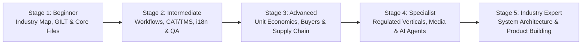

> **Mandate Reference:** `ATLAS_MASTER_PROMPT.md` — Part 28 and Part 32 (Deliverable 3).

---

## 1. Pedagogical Logic: Why This Sequence Works

Outsiders entering the language industry frequently fail because they jump straight into either **linguistic theory** (without understanding software files, CAT/TMS engineering, or unit economics) or **generic AI wrappers** (without understanding why enterprise localization buyers reject tools that break XLIFF tags, violate ISO 13485/ISPOR compliance, or ignoreTranslation Memory ownership).

This roadmap sequences learning across **five progressive stages**:

1. **First, map the economic territory (Volumes 1–4):** Understand who buys language services, why a $70B+ services market exists alongside a $200B+ wider language economy, and how money flows from enterprise buyers down through multi-language vendors (MLVs), single-language vendors (SLVs), and freelance specialists.
2. **Second, master the physical mechanics of text and files (Volumes 6–10):** Inspect real `.xliff`, `.tmx`, `.tbx`, `.json`, `.idml`, and `.ttml` files; understand Unicode, BCP 47, CLDR, ICU MessageFormat, CAT tools, and MQM quality scorecards.
3. **Third, master specialist high-moat verticals (Volumes 5, 11, 12):** Learn why clinical trials require ISPOR dual-forward/back-translation and cognitive debriefing, why OTT streamers require frame-accurate IMSC1 timed text, and why EU MDR medical devices mandate 24-language traceability.
4. **Fourth, master commercial operations and AI transformation (Volumes 13–17):** Calculate gross margin vs. contribution margin across fuzzy-match grids, evaluate enterprise RFPs, and architect RAG + MTQE + human-in-the-loop agentic workflows.
5. **Fifth, build real industry products (Volumes 18–20):** Apply the 25 Failure Modes, 30 Case Studies, and 100 Open-Source Lab blueprints to ship high-leverage software or services.

---

## 2. The Five Proficiency Stages (Part 28)

| Stage | Target Competency | Core Volumes | Hands-On Tools & Files | Capstone Exercise & Milestone |
| :--- | :--- | :--- | :--- | :--- |
| **Stage 1: Beginner** | Understand GILT (Globalization, Internationalization, Localization, Translation), the 6 ecosystem sectors, core participant types, and why raw machine translation is not localization. | Vol 1, Vol 3 (Ch 3.1–3.2), Vol 4 | OmegaT / MateCat, plain-text editor inspecting `.xliff`, `.tmx`, `.tbx`, `.srt`, `.json` |Deconstruct a 5-language SaaS localization quote: calculate weighted words using a TM fuzzy-match grid and identify every role from PM to reviser. |
| **Stage 2: Intermediate** | Execute end-to-end production workflows across CAT/TMS platforms, configure i18n resource files, and run deterministic + analytic LQA checks. | Vol 6, Vol 7, Vol 8, Vol 9 (Ch 9.1–9.2), Vol 10 | Trados Studio / memoQ / Phrase / Lokalise, ApSIC Xbench, Okapi Rainbow, ICU MessageFormat | Extract hardcoded strings from a React/Flutter app into ICU `.json`/`.arb`, run pseudo-localization to catch 35% German UI expansion, and audit target `.xliff` with Xbench + MQM. |
| **Stage 3: Advanced** | Analyze national markets, corridor economics, LSP department KPIs, enterprise buyer procurement RFPs, and project P&L unit economics. | Vol 2, Vol 3 (Ch 3.3–3.6), Vol 13, Vol 14 | BMS calculators (Plunet/XTRF logic), multi-currency margin models, RFP scoring matrices | Build a full P&L financial simulation for a 15-language enterprise account comparing traditional TEP vs. MTPE vs. AI-routed workflows, optimizing for >48% gross margin. |
| **Stage 4: Specialist** | Master high-barrier regulated and technical verticals: Clinical/Life Sciences (ISPOR/EU MDR), Legal/Patents, Media/AVT (OTT subtitling/dubbing), and BiDi/CJK engineering. | Vol 5, Vol 9 (Ch 9.3–9.4), Vol 11, Vol 12, Vol 17 | OOONA / Subtitle Edit, Adobe InDesign (`.idml`), W3C i18n checker, COMET/MetricX QE | Design an ISO 13485 / ISPOR-compliant clinical eCOA localization pipeline AND an OTT 10-language subtitle/dubbing delivery spec passing Netflix Photon QC rules. |
| **Stage 5: Industry Expert** | Architect AI-native localization systems, audit unknown-unknown industry gaps, and build commercial micro-SaaS, open-source tools, or specialized language businesses. | Vol 15, Vol 16, Vol 18, Vol 19, Vol 20 | Python/TypeScript, Playwright, Tree-sitter AST, LLM routing + COMET-Kiwi QE harnesses | Ship one working tool from the **Open-Source Language Industry Lab** (Vol 19) or complete a full 18-point venture blueprint from the **Opportunity Radar**. |

---

## 3. Four Timeline Tracks (30-Day, 90-Day, 6-Month, 12-Month)

### Track A — The 30-Day Intensive Sprint (Executive, Product Builder & Founder Crash Course)
*Goal: Speak fluently with any LSP executive, enterprise localization director, or localization engineer within 4 weeks.*

- **Week 1 (The Industry & Economics):** Read Architecture Deliverables 1–6 + **Volume 1 (Ch 1.1–1.7)** + **Volume 2 (Ch 2.1 Market Sizing)** + **Volume 14 (Ch 14.1–14.2 Pricing & Margins)**.
- **Week 2 (Files, CAT/TMS & i18n Mechanics):** Study **Volume 7 (CAT vs. TMS)** + **Volume 8 (XLIFF, TMX, TBX, JSON, IDML, SRT/TTML)** + **Volume 9 (Unicode, BCP 47, CLDR, ICU Plurals, RTL)**.
- **Week 3 (Verticals, Quality & Regulated Moats):** Study **Volume 10 (ISO 17100/18587/5060 & MQM)** + **Volume 11 (Media/OTT)** + **Volume 12 (Clinical ISPOR & Legal)**.
- **Week 4 (AI Disruption & What to Build):** Study **Volume 15 (Agentic AI Localization)** + **Volume 18 (Failure Modes)** + **Volume 19 (Opportunity Radar & Open-Source Lab)**. Build 1 prototype tool.

### Track B — The 90-Day Practitioner & Operator Curriculum
*Goal: Transition into a Localization PM, Localization Engineer, Enterprise Program Manager, or AI Localization Architect.*

- **Month 1 (Foundations & Linguistic Corridors):** Complete Volumes 1, 2, 3, and 4 in full. Master the 4-perspective geographic matrix and the economics of Top 14 language pairs.
- **Month 2 (Production Engineering, Tools, Files & Quality):** Complete Volumes 6, 7, 8, 9, and 10. Hands-on labs: write custom XML/JSON parsing rules, inspect raw `.sdlxliff` and `.idml` packages, run Xbench regex QA, and score 1,000 words using the MQM framework.
- **Month 3 (Business Operations, Verticals & AI Systems):** Complete Volumes 5 (selected 25 core verticals), 13, 14, and 15. Draft a mock enterprise RFP response, model a 20-department LSP operation, and deploy a RAG + MTQE translation evaluation script.

### Track C — The 6-Month Specialist & Domain Mastery Track
*Goal: Achieve deep domain authority across regulated verticals, media localization, and cross-border operations.*

- **Months 1–2:** Complete the 90-Day Practitioner core (Volumes 1–4, 6–10).
- **Months 3–4:** Complete all **100 Localization Verticals (Volume 5)** + **Volume 11 (Media Localization)** + **Volume 12 (Clinical, Pharma, MedTech, Legal & Finance)**.
- **Months 5–6:** Complete **Volumes 13, 14, 15, 16, and 17** (IP, GDPR/HIPAA, Voice Rights, Geopolitics, Tax/Financial Ops). Complete 10 end-to-end case study analyses from **Volume 18**.

### Track D — The 12-Month Master Industry Architect & Builder Program
*Goal: Complete mastery of all 20 Volumes + shipping a portfolio of open-source localization infrastructure and commercial SaaS/agent prototypes.*

- **Quarter 1 (Q1):** Master Layer 1 (Volumes 1, 2, 3, 4) — Industry structure, global markets, linguistics, and core services.
- **Quarter 2 (Q2):** Master Layer 2 Part A (Volumes 5, 6, 7, 8, 9) — All 100 verticals, 12 workflows, software ecosystem, 60+ file formats, and extreme-detail i18n engineering.
- **Quarter 3 (Q3):** Master Layer 2 Part B & Layer 3 (Volumes 10, 11, 12, 13, 14, 15, 17) — Quality standards, media, regulated industries, LSP/buyer business operations, unit economics, AI agent orchestration, and regulatory ethics.
- **Quarter 4 (Q4):** Master Layer 4 (Volumes 16, 18, 19, 20) — All 30 Case Studies, 25 Failure Modes, Opportunity Radar evaluation, and building 3–5 functional tools from the **100-Project Open-Source Language Industry Lab**.
