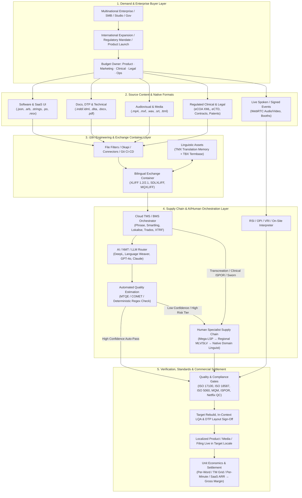
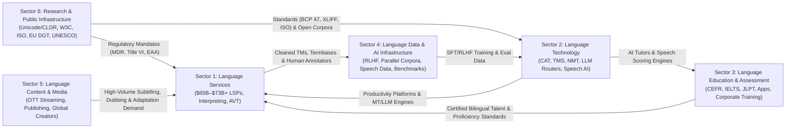
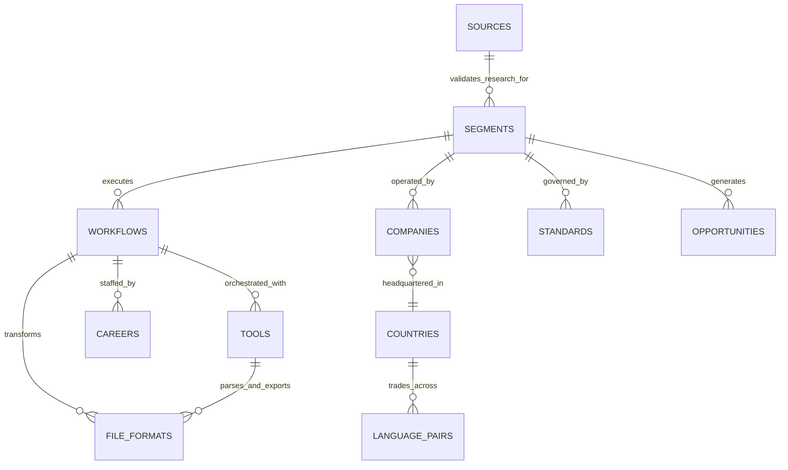

> **Mandate Reference:** `ATLAS_MASTER_PROMPT.md` — Part 32 (Deliverable 4), Part 18, and Mandatory Addendum A & C.

---

## 1. Master End-to-End Value & Production Knowledge Graph

This primary graph traces how an **Enterprise Buyer's business objective** flows through **content types, file formats, TMS/CAT technology, supply-chain tiers, AI/human workflows, and quality standards** to generate **global revenue**.

---

## 2. The 6-Sector Ecosystem Intersection Graph (Addendum C.1)

How the six macro-sectors of the global language economy feed data, talent, software, and revenue into one another:

---

## 3. Traditional vs. AI-Enabled Agentic Workflow Map (Addendum A.5)

Comparing the legacy linear cascade against the modern risk-tiered agentic localization architecture:

```mermaid
flowchart TB
    subgraph TRAD["A. Traditional Linear Cascade (High Latency, Manual Handoffs)"]
        T1["Client Email / Manual File Drop"] --> T2["LSP PM Manual Quote & File Prep"]
        T2 --> T3["TM Leverage + Static Generic MT"]
        T3 --> T4["Subcontracted SLV / Freelance Translator (T)"]
        T4 --> T5["Second Linguist Bilingual Revision (E)"]
        T5 --> T6["DTP / Proofreading (P) & Xbench Check"]
        T6 --> T7["PM Manual Delivery & 60-Day Invoice"]
    end

    subgraph AGENTIC["B. AI-Enabled Risk-Tiered Agentic Pipeline (Continuous, Context-Aware)"]
        A1["Git CI/CD / CMS Webhook / API Trigger"] --> A2["Ingestion & Risk Classification Agent<br/>(Tier 1 Regulated vs Tier 2 UI vs Tier 3 Long-Tail)"]
        A2 --> A3["Context Harvester & RAG Agent<br/>(Playwright UI Screenshots + Vector TM + TBX Glossary)"]
        A3 --> A4["Dynamic Model Router<br/>(Selects Best LLM/NMT per Language Pair & Domain)"]
        A4 --> A5["Deterministic Syntax/Tag Linter + COMET/LLM-MQM Judge"]
        A5 -- "Score >= Threshold & Tier 3" --> A7["Automated PR Merge / OTA Delivery"]
        A5 -- "Score < Threshold OR Tier 1/2" --> A6["Specialist Human Linguist-in-the-Loop<br/>(In-Context Visual Review)"]
        A6 --> A7
        A7 --> A8["Continuous Preference Loop<br/>(Human Edits Update TM & Fine-Tune Prompts)"]
        A8 -.-> A3
    end
```

---

## 4. Relational Entity Schema Graph (`src/data/*.json`)

How the 11 structured JSON databases in this repository link together:

