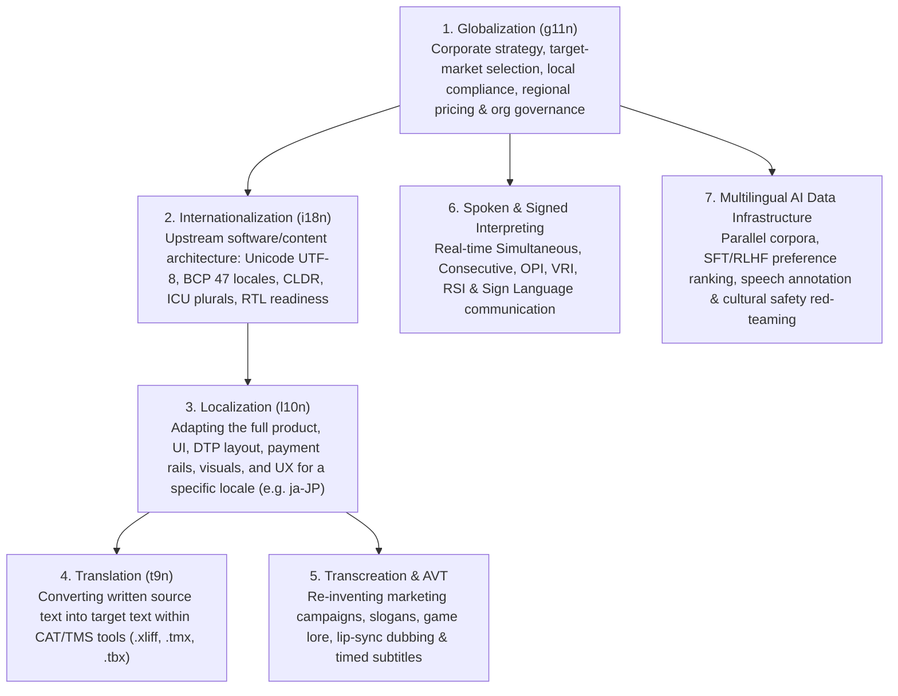

> **Volume 1 — The Language Industry: From Zero to Expert**  
> **Mandate Reference:** `ATLAS_MASTER_PROMPT.md` (Parts 1, 2, 3, 4.1, 31, 32, and Mandatory Addenda A, B, C, D)

---

## 1. What the Language Industry Actually Is (And Why Outsiders Misunderstand It)

To an outsider, the "language industry" sounds like a cottage profession of bilingual people converting sentences from one language into another—a function that many assume large language models (LLMs) or consumer translation apps have already turned into a free utility.

To an insider operating across enterprise globalization, clinical research, or streaming entertainment, **translation is only one step inside a complex industrial compliance, engineering, and cultural adaptation machine**. Consider what actually happens in commercial reality:

- When **Pfizer or Novartis** runs a Phase III oncology clinical trial across 38 countries, translating a Patient-Reported Outcome (ePRO) questionnaire on an electronic tablet cannot be handed to an unverified chatbot. Under **FDA 21 CFR** and **EMA** regulatory frameworks following **ISPOR Linguistic Validation Principles**, the instrument must undergo dual independent forward translations, reconciliation, blind back-translation by native English medical linguists, harmonization with the clinical instrument developer, in-country **cognitive debriefing interviews** with 5–8 native patients per country, and 100% pixel-accurate screenshot verification in an **ISO 13485**-certified quality management system. A single mistranslated severity anchor ("mild" vs. "slight") can invalidate $150M+ in clinical trial endpoint data.
- When **a B2B SaaS platform** deploys continuous software updates across 25 locales, the bottleneck is rarely raw lexical translation. It is **Internationalization (i18n) engineering**: extracting hardcoded UI strings into **ICU MessageFormat** `.json` or `.arb` resource files, handling six grammatical plural categories in Arabic (`zero, one, two, few, many, other` per **Unicode CLDR**), preventing **30–35% German text expansion** from overflowing fixed CSS containers, mirroring Right-to-Left (RTL) layouts via the **Unicode Bidirectional Algorithm (UAX #9)**, and harvesting live DOM screenshots so translators know whether the English string `"Post"` is a noun (a blog entry) or a verb (to submit a ledger transaction).
- When **an emergency medical physician** in a US hospital treats a patient speaking Rohingya, Hmong, or American Sign Language (ASL) at 2:00 AM, federal law (**Title VI of the Civil Rights Act** and **Section 1557 of the Affordable Care Act**) mandates immediate access to a qualified medical interpreter via **Over-the-Phone Interpreting (OPI)** or **Video Remote Interpreting (VRI)** within seconds—generating over $1.3B+ in annual revenue for the largest interpreting provider alone (**LanguageLine Solutions**).

### The Core Definition

The **Global Language Industry** (also termed the **Global Language Economy**) is the totality of commercial enterprises, technology platforms, data infrastructure providers, educational institutions, public bodies, and specialist professionals that enable products, software, regulated documents, audiovisual media, spoken/signed communication, and artificial intelligence systems to function accurately, legally, culturally, and commercially across all human languages, scripts, and locales.

---

## 2. The Canonical GILT Architecture (Plus Transcreation, Interpreting & Data)

Within enterprise technology and product localization, the foundational operational hierarchy is known by the acronym **GILT** (**G**lobalization, **I**nternationalization, **L**ocalization, **T**ranslation), which must be expanded to include **Transcreation**, **Interpreting**, and **Language Data Engineering**:

### Why the Numeronyms Exist (`g11n`, `i18n`, `l10n`, `t9n`)
Originated by Digital Equipment Corporation (DEC) engineers in the late 1980s, numeronyms count the number of letters between the first and last letter of each term:
- **`i18n`** = `i` + 18 letters (`nternationalizatio`) + `n`
- **`l10n`** = `l` + 10 letters (`ocalizatio`) + `n`
- **`g11n`** = `g` + 11 letters (`lobalizatio`) + `n`
- **`t9n`** = `t` + 9 letters (`ranslatio`) + `n`

### The Critical Rule of GILT Dependency
> **Insider Axiom:** *Localization failure is almost always an upstream Internationalization (`i18n`) failure.*  
> If software engineers hardcode ASCII dates (`MM/DD/YYYY`), concatenate sentence fragments in code (`"Deleted " + count + " files"`), or bake English text inside flattened raster `.png` graphics, no translator or AI model on Earth can localize the product without expensive emergency re-engineering.

---

## 3. The 6-Sector Language Industry Ecosystem (Addendum C.1)

To avoid the classic blind spot of equating the entire language economy with Language Service Providers (LSPs), we map all **six distinct sectors** and their financial and operational boundaries:

| Sector | What It Sells | Primary Buyer Personas | Core Unit of Billing | Primary Technology & Standards |
| :--- | :--- | :--- | :--- | :--- |
| **1. Language Services** | Written translation, localization, MTPE, transcreation, OPI/VRI/RSI/on-site interpreting, subtitling, dubbing, DTP, linguistic validation | VP of Localization, Clinical Trial Director, General Counsel, Hospital Language Access Coordinator | Per source word ($0.04–$0.28+), per character (CJK), per interpreter minute ($0.75–$2.50/min), per audio minute ($7–$90/min), per hour ($35–$120/hr) | CAT/TMS (`XLIFF`, `TMX`, `TBX`), BMS (Plunet, XTRF), `ISO 17100`, `ISO 18587`, `ISO 5060`, `ISPOR` |
| **2. Language Technology** | Desktop/Cloud CAT tools, Enterprise TMS platforms, Neural MT APIs, LLM routing hubs, automated LQA tools, subtitling/dubbing SaaS | Head of Localization Technology, CTO/VP Engineering, LSP Operations Director | Per-seat SaaS subscription, tier-based hosted words/strings, API consumption ($10–$25 per 1M characters or token cost) | Trados, memoQ, Phrase, Smartling, Lokalise, Crowdin, DeepL, OOONA, ApSIC Xbench, W3C ITS 2.0 |
| **3. Language Education & Assessment** | Consumer learning apps, B2B corporate language benefits, 1-on-1 live tutoring marketplaces, high-stakes standardized proficiency exams | Individual learners, Chief HR Officer / L&D Director, University Admissions, Immigration Ministries | Freemium B2C SaaS ($80–$180/yr), B2B per-seat license, per-exam fee ($150–$300 per IELTS/TOEFL test) | Adaptive learning engines, automated speech scoring, `CEFR` (A1–C2), `JLPT`, `IELTS`, `TOEFL`, `ACTFL` |
| **4. Language Data & AI Infrastructure** | Multilingual SFT prompt-response writing, RLHF preference ranking, domain red-teaming, dialect speech recording, parallel corpus licensing | Frontier AI Labs (OpenAI, Anthropic, Google, Meta, Mistral), Sovereign AI Programs, Enterprise AI teams | Per annotated task/turn, per specialist hour ($25–$120/hr for coding/medical bilinguals), per validated speech hour ($50–$300/hr) | Label Studio, Scale Studio, Argilla, `JSONL`, `Parquet`, `WAV/FLAC`, Inter-Annotator Agreement (IAA) |
| **5. Language Content, Publishing & Media** | Global OTT streaming libraries, theatrical dubbing adaptations, literary translations, multi-language YouTube channels, international news | Chief Content Officer, International Publishing Editor, Studio Distribution VP, Global Creator | Project package price, per runtime minute, royalty + advance (literary publishing), ad-revenue share | `TTML/IMSC1`, `SMPTE IMF`, Pro Tools ADR, Netflix Timed Text Style Guides, ISBN/ONIX metadata |
| **6. Language Research & Public Infrastructure** | Unicode/CLDR standards, government translation bureaus (EU DGT, UN, Canada Translation Bureau), computational linguistics research, language preservation | National governments, multilateral treaties, every OS/browser vendor, endangered language communities | Public tax appropriations, Horizon Europe / NSF research grants, consortium membership dues | `BCP 47`, `Unicode CLDR`, `ICU`, `CLARIN`, `ELRA`, `UNESCO World Atlas of Languages` |

---

## 4. Empirical Market Sizing & Methodology Reconciliation (Part 2 & Part 4.1)

One of the first questions an executive or investor asks is: **"How big is the language industry?"**  
Depending on which report you open, you will see figures ranging from **$55 billion** to **$75 billion**—or over **$200 billion**. In strict compliance with **Part 2 Research Rules**, we never repeat a single number without exposing *what* each research organization measures, its methodology, and why figures diverge.

### Market Sizing Comparison Table (Verified 2024–2026 Industry Benchmarks)

| Research Organization | Market Definition & Scope | Base Year & Currency | Reported Market Size | Forecast & CAGR | Geography | Methodology | Confidence & Limitations |
| :--- | :--- | :--- | :--- | :--- | :--- | :--- | :--- |
| **Nimdzi Insights** (*Nimdzi 100*, [nimdzi.com](https://www.nimdzi.com/)) | **Language Services & Localization Technology** (LSPs, interpreting, media localization, localization SaaS, and language data divisions of LSPs; excludes B2C language learning apps like Duolingo and general hyperscaler cloud AI compute) | **2024 / 2025** (USD) | **$71.7 Billion** (2024 base) → **~$75.7 Billion** (2025 estimate) | Projected **$90B–$96B by 2028–2029** (~5.5%–7.0% CAGR) | Global | Bottom-up revenue verification of top 100+ LSPs (audited filings + direct executive surveys) combined with statistical long-tail modeling of ~25,000+ global agencies and freelancers. | **High Confidence** for top 100 LSP ranking; **Limitation:** Long-tail extrapolation of micro-agencies in fragmented markets (China, LATAM, MENA) relies on multiplier estimates. |
| **CSA Research** (*Global Market Study*, [csa-research.com](https://csa-research.com/)) | **Outsourced Language Services & Translation Technology** (Strictly traditional and tech-enabled outsourced written translation, interpreting, and CAT/TMS software; historically conservative on adjacent AI data/BPO revenue) | **2023 / 2024** (USD) | **~$55 Billion – $60+ Billion** (historical series trajectory) | **~4%–6% CAGR** (moderated by unit-price compression from MT/LLMs offsetting volume growth) | Global | Structured sample survey of thousands of global LSPs stratified by NAICS/NACE codes, employee headcount, and revenue productivity per employee. | **High Methodological Rigor**; **Limitation:** Excludes in-house enterprise localization payroll, pure-play frontier AI labs, and broader BPO/content services. |
| **Slator** (*Slator Language Industry Market Report & LSPI*, [slator.com](https://slator.com/)) | **Language Services & Language AI/Tech Ecosystem** (Categorizes Super Agencies >$200M, Leaders $25M–$200M, Challengers $8M–$25M, Boutiques $1M–$8M, plus standalone Translation Tech/AI providers) | **2024 / 2025** (USD) | **~$65 Billion – $72 Billion** core services + fast-expanding **Language AI** software layer | **3%–6% on traditional services**; **15%–25%+ on Language AI & automated dubbing/interpreting solutions** | Global | Financial analysis of public companies (RWS, Teleperformance/LanguageLine, Keywords, Straker, Honyaku Center, Zoo Digital) + verified private submissions in the Slator LSPI. | **High Financial Transparency** on listed peers; **Limitation:** Many mid-sized private LSPs decline to disclose audited revenue, requiring range estimates. |
| **European Language Industry Survey (ELIS)** ([elis-survey.org](https://elis-survey.org/)) | **Multi-Stakeholder Operational & Sentiment Benchmark** (Jointly run by EUATC, Elia, FIT Europe, GALA, EMT, Women in Localization, and LIND-Web/European Commission DGT) | **2024 / 2025 Annual Survey** (EUR) | Tracks **YoY revenue growth, per-word rates, and AI impact** rather than single macro USD total | Reports decelerating traditional word-rate growth alongside surging MTPE/LLM workflow penetration | Europe & Global respondents (1,000+ participants) | Anonymous empirical survey across 4 distinct cohorts: LSPs, Independent Language Professionals (freelancers), Enterprise Buyers, and University Training Institutes. | **High Operational Truth** on freelancer rate stagnation vs. enterprise budget behavior; **Limitation:** Self-reported sentiment sample skewed toward European practitioners. |
| **Atlas Consolidated 6-Sector Language Economy Estimate** (*Synthesized Benchmark*) | **All 6 Sectors Combined:** (1) Language Services ~$72B + (2) Dedicated Language Tech ~$5B + (3) Global Language Education & Testing ~$85B + (4) Multilingual AI Data ~$6B + (5) Direct AVT/Publishing ~$8B + (6) Public/Institutional Infrastructure ~$5B | **2025 / 2026** (USD) | **~$180 Billion – $210+ Billion** (Total Global Language Economy) | **~6%–9% blended CAGR** driven by AI data infrastructure, digital language assessment, and Jevons-paradox content explosion | Global | Sector-by-sector aggregation preventing double-counting between LSP data divisions (e.g., RWS TrainAI, TransPerfect DataForce) and standalone providers. | **Synthesized Macro Estimate**; clearly distinguishes the **~$72B–$76B core localization/interpreting services market** from the **~$200B+ wider language economy**. |

### Why Market Estimates Differ: 5 Structural Reasons
1. **The "In-House vs. Outsourced" Boundary:** If Apple, Google, Netflix, or the European Commission employs thousands of in-house localization managers, linguists, and i18n engineers directly on corporate payroll, their salaries **never appear** in outsourced LSP revenue totals—unless they purchase third-party vendor services.
2. **Mega-LSP Diversification into Non-Translation Revenue:** Look closely at the top companies on the Nimdzi 100 or Slator LSPI:
   - **TransPerfect ($1.23B+ in 2024)** generates substantial revenue from legal e-discovery hosting, clinical trial technology (Trial Interactive), and AI data collection (DataForce).
   - **Keywords Studios (€780M+ group revenue prior to its £2.2B EQT take-private)** generates the majority of its group revenue from game co-development, art creation, and player support, with game localization, audio, and LQA representing a specialized subset (~20–25%).
   - **RWS (£718.2M / ~$910M in FY24)** blends language services, IP patent filing services, enterprise content management software (Tridion), CAT/NMT software (Trados, Language Weaver), and AI training data (TrainAI).
3. **Interpreting vs. Written Translation Divergence:** Over-the-Phone and Video Remote Interpreting (led by **LanguageLine Solutions at ~$1.3B+**, CyraCom, Propio, and AMN Healthcare) operates on healthcare telecom economics (~30% EBITDA margins) that behave completely differently from per-word software/document translation.
4. **Generalist Research Firm Inflation Trap:** Beware of syndicated general market reports claiming the "NLP / Machine Translation Market is $150B by 2030." Those reports lump all hyperscaler LLM/cloud revenue (AWS, Azure, Google Cloud) into language industry totals. **Never conflate general cloud compute with addressable language industry spend.**
5. **Currency Fluctuation Effects:** Because roughly 40–45% of LSP revenue originates in USD, 35–40% in EUR/GBP, and 10–15% in JPY/CNY/KRW, a 15% depreciation of the Japanese Yen (`JPY`) or Euro (`EUR`) against the US Dollar makes domestic Japanese LSPs (like Honyaku Center) appear to shrink in USD terms even when growing in local Yen.

---

## 5. Why the Language Industry Exists: The 5 Irreducible Economic Drivers

Why do corporations and governments spend over $75 billion a year on language services and technology instead of requiring the world to operate in English or running free browser auto-translate?

1. **Revenue Expansion & The "Can't Read, Won't Buy" Law:** Across multiple waves of **CSA Research's** *Can't Read, Won't Buy* global consumer studies surveying thousands of shoppers across 29+ countries, **76% of online consumers prefer to buy products with information in their native language**, and **40% state they will never buy from websites in other languages**. Entering Japan, Germany, France, Brazil, Korea, or Saudi Arabia without native localization sacrifices 50–80% of addressable market conversion.
2. **Statutory & Regulatory Compulsion (Non-Negotiable Compliance):**
   - **EU Medical Device Regulation (MDR 2017/745 & IVDR 2017/746):** A medical device cannot legally carry a CE mark or be sold across the European Union unless its Instructions for Use (IFUs), safety labels, and operator UI are accurately translated into the official national languages required by each Member State (up to 24 languages).
   - **US Healthcare & Courts (Title VI & ACA Section 1557):** Any US hospital or clinic receiving Medicare/Medicaid funds is legally required to provide qualified medical interpreting (not an ad-hoc family member or unverified consumer app) to Limited English Proficient (LEP) and Deaf/Hard-of-Hearing patients.
   - **Quebec Bill 96 / France Toubon Law / EU Institutional Parity:** Strict civil and commercial statutes mandate French-first product packaging, software UIs, employment contracts, and public service parity.
3. **Liability, Brand Trust & High-Stakes Asymmetric Risk:** The cost of translating a 10,000-word aviation maintenance manual or pharmaceutical dosage leaflet into Japanese is ~$2,000–$3,000. The cost of a single hallucinated negation or wrong unit conversion (`mg` vs. `mcg`, or `"do not lubricate"` vs. `"lubricate"`) is a product recall, fatal patient harm, or a $50M+ class-action lawsuit.
4. **Technical & Structural Asymmetry Across Human Languages:** Human languages are not 1-to-1 cipher codes of English. Translating English into Arabic requires flipping the entire visual coordinate system from Left-to-Right (LTR) to Right-to-Left (RTL) and supporting 6 grammatical plural forms. Translating English into Japanese requires choosing among three writing systems (Kanji, Hiragana, Katakana) and encoding exact social hierarchy (*keigo*) even when the English source sentence contains zero politeness markers.
5. **The AI Training & Evaluation Paradox:** The rise of frontier LLMs has created an entirely new multi-billion-dollar demand loop: **LLMs cannot reach native reasoning, cultural alignment, or medical/legal accuracy in 100+ languages without massive human-curated multilingual SFT, RLHF preference data, and native linguistic evaluators.**

---

## 6. Insider Reality Check: What a 20-Year Veteran Knows That an Outsider Does Not

- **The "Cost of Translation" is Only 30–40% of the Total Cost of Localization:** In enterprise software or regulated publishing, paying for the actual word translation is the smallest part of the friction. The hidden 60–70% of effort sits in **project management, file engineering (fixing broken XML/IDML tags), context harvesting, terminology arbitration with grumpy in-country sales managers, desktop publishing (DTP) layout fixes, and in-context functional LQA testing**.
- **In-Country Reviewer (ICR) Bottlenecks:** Almost every enterprise localization program breaks down not at the LSP translation stage, but when translated files are sent to the client's local regional salesperson in Tokyo or Paris for "final approval." The local salesperson is not a trained linguist, delays the launch by three weeks, rewrites the approved corporate glossary based on personal preference, and introduces fresh grammatical errors.
- **The Multi-Tier Subcontracting Cascade:** When a Fortune 500 buyer pays a Tier-1 Mega-LSP **$0.22 per word** for English-to-Korean marketing localization, that file is often routed to a regional Single-Language Vendor (SLV) in Seoul for **$0.11 per word**, who in turn assigns it to a freelance translator for **$0.055–$0.07 per word**. Only **25% to 35%** of the enterprise retail price typically reaches the person who actually translates the text.

---

## 7. Mandatory Addendum A — AI Impact & Opportunity Brief

> **Subject Analyzed:** The Global Language Industry & 6-Sector Language Economy (Macro Overview)

| # | Assessment Field | Verified Analysis & Strategic Verdict |
| :--- | :--- | :--- |
| **1** | **Subject Analyzed** | Global Language Industry (6 Sectors: Services, Tech, Education, AI Data, Media, Public Infrastructure) |
| **2** | **AI Disruption Score (1–10) & Confidence** | **8 / 10 (Extreme Structural Transformation)** · **Confidence: High** *(Scored 8/10 for core written translation/MTPE workflows; 4/10 for clinical/regulated liability sign-off; 6/10 for live high-stakes interpreting)* |
| **3** | **Current Commercial AI Deployment Status** | *Already commercially deployed* across 75–90%+ of enterprise TMS pipelines via Neural MT (DeepL, Language Weaver, Google) and LLM routers (Smartling AI Hub, Phrase NextMT, Lokalise AI), paired with automated MT Quality Estimation (MTQE). |
| **4** | **Core Tasks Automated Today** | First-pass written translation of high/medium-resource languages; TM/termbase fuzzy repair; automated ASR speech transcription; subtitle timecode auto-spotting; low-stakes customer support chat translation; deterministic tag/placeholder verification. |
| **5** | **Core Tasks Requiring Humans Today** | Regulated liability sign-off (ISPOR clinical trials, EU MDR medical devices, sworn court/patent filings); high-context UI disambiguation; creative brand transcreation; live high-stakes medical/court/diplomatic interpreting; theatrical lip-sync voice performance; RLHF evaluation of LLMs. |
| **6** | **Quality Parity Assessment** | On clean, self-contained prose in top 15 high-resource language pairs (`EN<->ES/DE/FR/PT`), frontier LLMs + domain RAG achieve 85–95% raw segment acceptability, requiring human intervention primarily on terminology, brand voice, and cultural nuance. On short, uncontextualized software UI strings (`"Charge"`, `"Post"`, `"Lead"`), raw AI still fails 25–40% of the time without visual context injection. |
| **7** | **Cost & Pricing Impact** | Direct per-word translation unit prices are compressing by **30% to 60%** as buyers shift from traditional $0.18/word human TEP to $0.06–$0.10/word AI+MTPE or subscription/token-tiered models. |
| **8** | **Margin & Unit Economics Impact** | Tech-forward LSPs that price by deliverable/outcome while automating 70% of production via MTQE + light human review are **expanding gross margins from 40% to 55%+**, whereas legacy labor-arbitrage agencies billing pure pass-through hours face severe revenue and margin compression. |
| **9** | **Demand Expansion vs. Contraction (Jevons Paradox)** | **Massive Volume Expansion + Unit Price Compression.** As the cost of localizing 1,000 words drops by 60–80%, enterprises localize 5x–10x more content tiers (long-tail knowledge bases, internal training, user reviews, 30+ language YouTube audio tracks) that were previously left untranslated. Total words/minutes processed globally is expanding exponentially even as revenue per word falls. |
| **10** | **Employment & Role Evolution Outlook** | Generalist commodity translators face acute displacement; demand shifts toward **AI-augmented domain editors, LQA evaluators, Localization/i18n Engineers, Multimedia/AVT specialists, and Multilingual AI Data/RLHF specialists**. |
| **11** | **Most Vulnerable Legacy Players/Models** | Mid-sized generalist SLVs/MLVs relying on manual email file handoffs, low-complexity business document translation, and undifferentiated per-word markup without proprietary connectors or vertical regulatory moats. |
| **12** | **Most Resilient Players/Models** | Regulated life sciences & IP specialists (ISO 13485 / ISPOR / WIPO moats), enterprise TMS platforms owning the system-of-record integration (Smartling, Phrase, Lokalise), OPI/VRI healthcare interpreting networks (LanguageLine, Propio), and multilingual AI data providers. |
| **13** | **Key Adoption Barriers & Regulatory Brakes** | Statutory mandates requiring certified human attestation (FDA/EMA, court sworn translators); enterprise data residency & zero-retention LLM privacy mandates; LLM subword tokenization taxes and hallucination risks in low-resource languages; voice actor biometric union protections (SAG-AFTRA). |
| **14** | **Key Disruption Accelerators** | Context-aware multimodal LLMs (ingesting UI screenshots + video + text simultaneously); reference-free Quality Estimation (COMET-Kiwi / LLM-as-a-Judge) removing the need to human-review 100% of segments; expressive low-latency speech-to-speech synthesis. |
| **15** | **2026–2027 Outlook (Immediate)** | *Already commercially deployed / Commercially emerging:* Risk-tiered routing becomes universal—Tier 3 content (support/reviews) runs 95% autonomous AI+QE; Tier 2 (product UI/docs) uses RAG-LLM + targeted human exception review; Tier 1 (clinical/legal/flagship marketing) remains human-led. |
| **16** | **2028–2030 Outlook (Structural)** | *Commercially emerging:* Agentic localization pipelines autonomously crawl staging builds, fix i18n bugs, harvest visual context, translate, run visual regression LQA, and open Git PRs with humans acting as exception governors and cultural directors. |
| **17** | **2031–2035+ Outlook (Long-Range)** | *Experimental / Speculative:* Real-time personalized multimodal rendering—games, media, and enterprise workspaces dynamically adapt voice, register, and cultural idioms in real time per user profile, shifting the industry from batch "file translation" to continuous "cross-cultural assurance & sovereign data stewardship." |
| **18** | **AI Opportunity Score (1–10)** | **9 / 10 (Exceptional Venture & Open-Source Build Potential)** |
| **19** | **Top 3 Buildable Product / Agent / Open-Source Ideas** | 1. **Autonomous Playwright Visual-Context Harvester** (crawls staging web/mobile apps on every Git PR and attaches live DOM screenshots + disambiguation notes to TMS keys). 2. **Pre-Commit i18n AST Defect Linter & ICU Autofixer** (open-source CLI scanning React/Vue/Flutter ASTs for hardcoded strings, broken concatenations, and missing plural categories). 3. **EU MDR 24-Language IFU Semantic Traceability Engine** (verifies regulatory change-impact across 24 EU languages in IDML/PDF medical device leaflets). |
| **20** | **Strategic Takeaway** | **For Learners:** Master files (`.xliff`, `.json`, `.idml`, `.ttml`), i18n engineering, and high-stakes domain verticals—never compete as a raw text-to-text human typewriter. **For Builders:** Build around **context starvation, pre-translation i18n defects, and post-translation compliance verification**, not generic "paste text and call OpenAI" wrappers. **For Operators:** Decouple client pricing from manual linguist hours; build vertical compliance moats and automated QE triage. |

---

## 8. Mandatory Chapter-Closing Review (Part 32 — 11 Items)

### 1. What I Learned
- The global language economy is a **6-sector ecosystem** worth **~$180B–$210B+**, anchored by a **~$72B–$76B core language services and localization technology market**.
- **GILT** (`g11n` → `i18n` → `l10n` → `t9n`) is a strict technical dependency chain: downstream translation and localization cannot succeed if upstream internationalization (`i18n`) is broken.
- Market size figures from **Nimdzi, CSA Research, Slator, and ELIS** differ because of clear methodological boundaries (outsourced LSP revenue vs. in-house payroll, inclusion of legal e-discovery/game co-dev/AI data divisions, and FX fluctuations).
- The industry is sustained by five irreducible drivers: consumer conversion (*Can't Read, Won't Buy*), statutory compliance (EU MDR, US Title VI/ACA 1557, Bill 96), asymmetric legal/clinical liability, deep linguistic/script divergence (RTL, CJK, CLDR plurals), and frontier AI's hunger for human-curated multilingual data.

### 2. Important Terminology Introduced
- **GILT (`g11n`, `i18n`, `l10n`, `t9n`)**
- **LSP (Language Service Provider)**, **MLV (Multi-Language Vendor)**, **SLV (Single-Language Vendor)**
- **CAT Tool** vs. **TMS (Translation Management System)** vs. **BMS (Business Management System)**
- **XLIFF**, **TMX (Translation Memory eXchange)**, **TBX (TermBase eXchange)**
- **MTPE (Machine Translation Post-Editing)** & **MTQE (Machine Translation Quality Estimation)**
- **OPI (Over-the-Phone Interpreting)**, **VRI (Video Remote Interpreting)**, **RSI (Remote Simultaneous Interpreting)**
- **ISPOR Linguistic Validation** & **Cognitive Debriefing**

### 3. Key Companies Referenced
- **Mega-LSPs & Interpreting Leaders:** TransPerfect ($1.23B+), LanguageLine Solutions / Teleperformance (~$1.3B+), RWS Holdings (£718.2M), Lionbridge, Keywords Studios (acquired by EQT), Welocalize, IYUNO.
- **Language Technology & AI Leaders:** DeepL, Smartling, Phrase, Lokalise, Crowdin, memoQ, OOONA, ApSIC (Xbench).
- **Multilingual AI Data Providers:** Scale AI, Appen, LXT, Centific, RWS TrainAI, TransPerfect DataForce.

### 4. Key Tools Referenced
- **Trados Studio**, **memoQ**, **Phrase TMS / Phrase Strings**, **Smartling**, **Lokalise**, **Crowdin**, **OOONA**, **ApSIC Xbench**, **Plunet**, **XTRF**.

### 5. Important File Formats Referenced
- **`.xliff` / `.sdlxliff` / `.mqxliff`** (Bilingual exchange containers)
- **`.tmx`** (Translation Memory exchange) & **`.tbx`** (Terminology exchange)
- **`.json` / `.arb` / `.strings`** (Software localization resource bundles)
- **`.idml`** (Adobe InDesign Markup Language for DTP)
- **`.ttml` / `.imsc1` / `.srt`** (Timed text & subtitling)

### 6. Industry Insights
- **The 30% Rule:** Raw word translation represents only 30–40% of enterprise localization friction; 60–70% sits in i18n engineering, visual context capture, terminology arbitration, DTP layout recovery, and LQA.
- **Supply Chain Margin Compression:** In traditional multi-tier subcontracting (Enterprise → Mega-LSP → Regional SLV → Freelancer), only 25–35% of the buyer's per-word fee reaches the human linguist.

### 7. Common Misconceptions Debunked
- *Misconception 1:* "LLMs have made the language industry obsolete." → **Reality:** LLMs compress per-word unit pricing on commodity text while exploding total localized content volume (Jevons paradox) and creating massive demand for i18n engineering, visual LQA, regulated validation, and multilingual RLHF data.
- *Misconception 2:* "Localization is just translating a string file." → **Reality:** Without upstream `i18n` (Unicode normalization, CLDR plural rules, RTL layout mirroring, dynamic date/currency formatting), translated strings break the application UI.

### 8. Practical Exercise
1. Open the [Relational Databases Explorer](/databases/) in this Atlas.
2. Compare **TransPerfect**, **LanguageLine Solutions**, **RWS**, and **DeepL** in the Companies table.
3. Calculate: If a SaaS company has 100,000 UI words to localize into **German (`EN -> DE`)**, **Japanese (`EN -> JA`)**, and **Arabic (`EN -> AR`)**, look up the typical rate ranges and technical risks in the **Language Pairs Database** (`src/data/language_pairs.json`) and list the top 3 engineering bugs that will occur if the developer only budgets for raw word translation.

### 9. Self-Assessment Quiz
1. What do the four components of **GILT** stand for, and why must `i18n` happen before `l10n`?
2. Why does **Nimdzi Insights** estimate the core market at ~$71.7B–$75.7B while **CSA Research** historically reports a smaller figure? Name at least three scope differences.
3. Under what legal regulations are US hospitals and EU medical device manufacturers *statutorily required* to purchase professional language services?
4. What is the difference between a **CAT tool**, a **TMS**, and a **BMS**?
5. What is **Jevons paradox** in the context of AI translation?

### 10. Questions That Remain Unanswered (Leading into Ch 1.2–1.7)
- How did the language industry evolve mechanically from ancient Silk Road and Toledo translators to the 1945 Nuremberg simultaneous interpreting trials, the 1954 Georgetown-IBM MT experiment, the 1990s Trados TM revolution, and 2026 agentic LLM pipelines? *(Covered in Chapter 1.2)*
- How exactly does a $500,000 enterprise RFP cascade financially and operationally from the client procurement portal down to a freelance translator's desktop? *(Covered in Chapters 1.3 & 1.7)*

### 11. Topics Requiring Further Research
- Detailed breakdown of **Eurostat NACE Rev. 2 Code M74.30** enterprise statistics vs. US Census **NAICS 541930** (Translation and Interpretation Services) for Volume 2's country-by-country baseline.
- Empirical tokenizer fertility ratios across all 22 Indian Eighth Schedule scripts and African low-resource languages for Volume 3 and Volume 15.

---

## 9. Mandatory Addendum B — 5-Expert Chapter Gap Analysis Report

| Expert Persona | Audit Findings & Identified Gaps in Initial Draft | Improvements Merged Directly into Final Chapter 1.1 |
| :--- | :--- | :--- |
| **1. 20-Year Localization Industry Veteran** | Initial draft needed sharper clarity on the **multi-tier subcontracting cascade** (how much money actually reaches the linguist) and the notorious **In-Country Reviewer (ICR) bottleneck**. | Added Section 6 (*Insider Reality Check*) quantifying the 25–35% linguist share in MLV→SLV→Freelancer cascades and documenting the corporate ICR bottleneck. |
| **2. Localization Technology Architect** | Needed explicit mention of **ICU MessageFormat**, **Unicode CLDR six-form Arabic plurals**, **UAX #9 Bidirectional Algorithm**, and **MTQE (COMET-Kiwi)** in the foundational definition so readers immediately grasp the engineering layer. | Integrated concrete `i18n` standards (`ICU`, `CLDR`, `UAX #9`, `XLIFF`, `TMX`, `TBX`) and automated Quality Estimation into Sections 1, 2, and 7. |
| **3. Localization Operations Director** | Highlighted that outsiders confuse **CAT**, **TMS**, and **BMS (Plunet/XTRF)** and overlook that translation is only 30–40% of total localization cost/effort. | Added the 30–40% translation vs. 60–70% ops/engineering/DTP/QA breakdown and clearly distinguished CAT, TMS, and BMS across the 6-sector table and glossary. |
| **4. Specialist Linguist (Clinical & CJK)** | Requested concrete domain examples showing why raw AI fails without human verification—specifically **ISPOR clinical cognitive debriefing** and **Japanese *keigo* / zero-pronoun UI disambiguation**. | Built Section 1 around the Phase III oncology ePRO ISPOR workflow and SaaS UI context disambiguation (`"Post"` / `"Charge"`). |
| **5. Localization Industry Researcher** | Required strict **Part 2 methodological transparency** explaining *why* Nimdzi ($71.7B–$75.7B), CSA, Slator, and ELIS numbers differ, plus an explicit warning against generalist "$150B NLP report" inflation. | Built the 8-column Market Sizing Comparison Table in Section 4 plus the 5 Structural Reasons for Estimate Divergence (including FX effects and mega-LSP non-translation divisions). |
