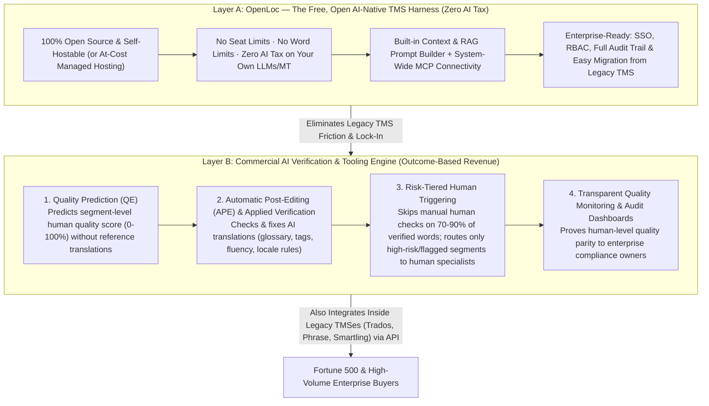

> **Volume 19 — The Industry Opportunity Radar & Open-Source Lab**  
> **Mandate Reference:** `ATLAS_MASTER_PROMPT.md` (Parts 19, 26, 27, 31, 32, and Mandatory Addenda A & B)

---

## 1. The ModelFront + OpenLoc Strategic Thesis: Why Verification & Open Harnesses Win

Most newcomers trying to build a startup in the language industry build the exact same dead-end product: **"Another wrapper that calls an LLM to translate text."**

Those startups fail for three structural reasons:
1. **Raw Translation Generation Is Commoditizing to Zero:** Frontier models (GPT-4o, Claude 3.5/3.7, Gemini, DeepL, Qwen, DeepSeek) already generate raw first-pass translations for fractions of a cent per thousand words.
2. **The Real Enterprise Bottleneck Is Verification, Not Generation:** When a Fortune 500 company translates 100 million words across software, patents, travel catalogs, or industrial manuals, they cannot blindly publish 100% raw AI output because of broken placeholders, terminology drift, or critical negation hallucinations. Yet paying human translators $0.14–$0.22/word to review 100% of those 100 million words destroys the entire ROI of AI.
3. **Legacy TMS Lock-In and the "AI Tax":** Traditional Translation Management Systems (built in the 2000s around human seat licenses and per-word markups) often charge an artificial **"AI tax"** (per-word or per-character surcharges just to route your own LLM/MT through their platform) and make it painful to pass rich visual/RAG context or connect external AI agents via **MCP (Model Context Protocol)**.

### How ModelFront Solved This (The "Chrome + Search Engine" Architecture)

**ModelFront** ([modelfront.com](https://www.modelfront.com/)) and its open AI-native TMS initiative **OpenLoc** ([openloc.com](https://openloc.com/)) pioneered a two-layer strategic architecture that serves as the gold-standard blueprint for building a category-defining language AI company:

### Why This Business Model Works ("Google Chrome vs. Google Search")
As ModelFront co-founder Adam Bittlingmayer framed the OpenLoc thesis:
- **OpenLoc is like Chromium/Android:** It is completely open, free to self-host, imposes zero AI tax, and lets enterprises use *any* LLM, MT engine, or verification agent via system-wide **MCP (Model Context Protocol)**.
- **Your Commercial AI Engine (QE, APE, Visual Context, Domain Compliance) is the Monetization Layer:** Because the TMS harness is open and frictionless, teams stop fighting legacy TMS paywalls and rapidly scale their automated word volume from 1 million words to 100+ million words. You monetize via **outcome-based pricing** on the AI verification, automatic post-editing, and specialist tools that make skipping manual human review safe at scale.

---

## 2. Our Product & Venture Roadmap for `language.shashwat.wtf`

Our strategy combines **three self-reinforcing flywheels** on `language.shashwat.wtf`:

1. **Flywheel 1 — The Open Knowledge Authority (All 20 Volumes + 11 Relational Databases Free):**
   - Ranks organically for every high-intent technical and commercial search query in localization (from `XLIFF 2.1 vs SDLXLIFF` and `ISPOR linguistic validation workflow` to `OpenLoc MCP configuration` and `EU MDR 24-language IFU requirements`).
   - Establishes immediate domain authority with VPs of Localization, i18n Engineers, and LSP technical directors.
2. **Flywheel 2 — Free In-Browser Interactive Micro-Tools (Lead & Usage Magnet):**
   - Every major volume is paired with a free, zero-signup interactive tool right on the site (starting with the **QE/APE Simulator**, **OpenLoc Zero-AI-Tax Savings Calculator**, and **ICU/XLIFF Linter** already live on the homepage).
3. **Flywheel 3 — Commercial API, MCP Agents & Enterprise OpenLoc Add-Ons:**
   - When an enterprise team wants to run those tools automatically across 10M+ words in CI/CD, GitHub Actions, OpenLoc, Phrase, or Smartling, they upgrade to our commercial API / MCP agents.

---

## 3. Top 5 High-Conviction Tools & Products to Build and Sell (18-Point Opportunity Evaluations)

In accordance with **Part 26** of `ATLAS_MASTER_PROMPT.md`, each opportunity is evaluated across all 18 required commercial and technical dimensions:

### Opportunity 1 — Domain-Calibrated Quality Prediction (QE) & Automatic Post-Editing (APE) API / MCP Server
- **1. Classification:** Enterprise AI SaaS / API / OpenLoc MCP Integration
- **2. Problem:** Enterprises using raw GPT-4o, Claude, or DeepL inside their TMS still pay human translators to review nearly 100% of segments because generic LLMs silently hallucinate numbers, drop inline XLIFF tags, or violate corporate termbases.
- **3. Target Customer:** Enterprise localization teams (>5M words/year), AI-forward LSPs, IP/Patent firms, E-commerce marketplaces.
- **4. Current Solution:** Manual 100% human MTPE, or crude rule-based QA (Xbench) that catches missing numbers but misses semantic mistranslations.
- **5. Existing Competitors:** ModelFront (category pioneer), TAUS EPIC/QE, Phrase MTQE, Unbabel/Widn.
- **6. Gap & Wedge:** Vertical-specific QE + APE tuned for **underserved high-growth corridors** (`EN ↔ Indic`, `EN ↔ JA/KO/ZH`, `EN ↔ AR`) and native **MCP server plug-and-play** with OpenLoc and Git repositories.
- **7. Core Technology:** Fine-tuned reference-free QE encoders (COMET-Kiwi / MetricX architecture) + deterministic AST tag/glossary verifier + surgical APE repair model.
- **8. Engineering Difficulty:** Medium-High
- **9. Build Cost:** Low initial compute ($500–$2,000 GPU fine-tuning on curated MQM datasets).
- **10. Monetization Model:** Outcome-based per-verified-word pricing ($0.004–$0.01/word verified and auto-fixed) or tiered enterprise annual commit ($25k–$150k/yr).
- **11. Addressable Market Size:** $1.5B–$3B+ (capturing 10–20% of the ~$15B+ enterprise MTPE spend).
- **12. Customer Acquisition:** Free interactive QE/APE benchmark sandbox on `language.shashwat.wtf` + one-click OpenLoc MCP plugin.
- **13. AI Potential:** 10/10 (Core product is applied verification AI).
- **14. Defensibility:** Proprietary false-positive/false-negative calibration matrices per domain and language pair.
- **15. Key Risks:** Uncalibrated threshold passing a critical defect in Tier-1 regulated text (mitigated by strict risk-tier guardrails).
- **16. MVP Specification:** REST API + OpenLoc MCP server accepting `(source, target, locale, tbx_glossary, risk_tier)` and returning `{ qe_score, decision: "AUTO_PUBLISH" | "APE_FIXED" | "HUMAN_REVIEW", ape_target, diff_explanation }`.
- **17. Open-Source vs. Commercial Split:** Open-source the MCP connector and evaluation benchmark harness; monetize the hosted calibrated QE/APE verification engine.
- **18. AI Opportunity Score:** **10 / 10**

---

### Opportunity 2 — Autonomous Playwright DOM Visual-Context Harvester for OpenLoc & Cloud TMS
- **1. Classification:** Developer Micro-SaaS / CI-CD AI Agent
- **2. Problem:** 60%+ of software LQA bugs happen because translators and LLMs translate isolated JSON keys (`"post_action"`, `"charge_btn"`, `"lead_status"`) with zero visual context.
- **3. Target Customer:** SaaS engineering & localization teams using OpenLoc, Lokalise, Crowdin, Phrase, or Smartling.
- **4. Current Solution:** Manual screenshot taking by PMs via Chrome extensions, or Figma plugins that go out of sync with live production code.
- **5. Existing Competitors:** Smartling Visual Context (enterprise-locked), Lokalise Figma plugin.
- **6. Gap & Wedge:** Fully autonomous headless browser crawl in GitHub Actions on every PR that maps live DOM nodes back to i18n keys and generates both **cropped bounding-box screenshots** and **Vision-LLM disambiguation notes**.
- **7. Core Technology:** Playwright + React/Vue/Flutter i18n AST source-map instrumentation + Vision LLM.
- **8. Engineering Difficulty:** Medium (Solo-buildable in 3 weeks).
- **9. Build Cost:** <$200 infrastructure cost.
- **10. Monetization Model:** $99–$499/month per repository SaaS (or bundled with managed OpenLoc hosting).
- **11. Addressable Market Size:** 50,000+ global SaaS and mobile app engineering teams.
- **12. Customer Acquisition:** Open-source GitHub Action marketplace listing + Volume 5/6/9 tutorials on `language.shashwat.wtf`.
- **13. AI Potential:** 9/10
- **14. Defensibility:** Deep CI/CD workflow integration into the developer PR loop.
- **15. Key Risks:** Complex auth walls on staging apps (solved via Playwright saved storageState sessions).
- **16. MVP Specification:** GitHub Action that runs on PRs touching `locales/en.json`, boots the preview URL, screenshots every modified key, and attaches the image + context note to OpenLoc/Lokalise/Crowdin via API.
- **17. Open-Source vs. Commercial Split:** Open-source the DOM key-instrumentation library; charge for the hosted cloud crawler & TMS sync dashboard.
- **18. AI Opportunity Score:** **9.5 / 10**

---

### Opportunity 3 — Managed OpenLoc Enterprise Hosting, Migration & Custom MCP Connector Studio
- **1. Classification:** Open-Core Platform + High-Margin Implementation & Managed Hosting
- **2. Problem:** Mid-market and Fortune 500 enterprises want to escape $50k–$250k/year legacy TMS contracts and "AI taxes" by adopting **OpenLoc**, but their internal DevOps teams want turnkey SOC2/ISO-27001 hosting, legacy TM/workflow migration, and custom CMS/ERP MCP connectors.
- **3. Target Customer:** Mid-to-large enterprises migrating off legacy TMS platforms.
- **4. Current Solution:** Paying bloated legacy TMS renewals or building brittle internal homegrown scripts.
- **5. Existing Competitors:** Legacy TMS vendors (Phrase, Smartling, XTM, Trados Enterprise).
- **6. Gap & Wedge:** First-mover specialist ecosystem partner offering **1-click OpenLoc cloud deployment + automated MCP migration agents + bundled QE/APE verification**.
- **7. Core Technology:** Docker/Kubernetes OpenLoc deployment, MCP migration agents (reading legacy TMS TMs, termbases, and workflow rules), SSO/SAML.
- **8. Engineering Difficulty:** Medium
- **9. Build Cost:** Low (Hostinger/Hetzner/AWS container orchestration).
- **10. Monetization Model:** Managed hosting + SLA support + per-word QE/APE verification add-on ($1,500–$5,000/month per enterprise).
- **11. Addressable Market Size:** $500M+ legacy TMS replacement wave.
- **12. Customer Acquisition:** Direct inbound from `language.shashwat.wtf` Volume 7 (TMS comparison) & live ROI calculator.
- **13. AI Potential:** 9/10
- **14. Defensibility:** High switching resistance once enterprise connectors, SSO, and custom MCP agents are deployed.
- **15. Key Risks:** Requires rock-solid uptime and security posture.
- **16. MVP Specification:** Automated migration CLI (`legacy-tms-to-openloc`) that converts `.tmx`, `.tbx`, `.sdlppx`, and project configs into an OpenLoc instance in under 10 minutes.
- **17. Open-Source vs. Commercial Split:** Open-source the migration CLI; monetize managed enterprise hosting and premium QE/APE verification.
- **18. AI Opportunity Score:** **9.5 / 10**

---

### Opportunity 4 — Pre-Commit i18n Defect & Concatenation AST Scanner (`i18n-doctor`)
- **1. Classification:** Open-Source CLI + Commercial GitHub App
- **2. Problem:** Developers constantly break localization before translators ever see a file—committing hardcoded strings, string concatenations (`"Deleted " + n + " items"`), and locale-unsafe `new Date().toLocaleDateString()` calls.
- **3. Target Customer:** Engineering teams, CTOs, Localization Engineers.
- **4. Current Solution:** Discovering broken builds weeks later during manual LQA testing, or legacy enterprise tools (Lingoport Globalyzer) costing $30k+/yr.
- **5. Existing Competitors:** ESLint plugins (single-language, no autofix into ICU MessageFormat).
- **6. Gap & Wedge:** Multi-framework Tree-sitter AST scanner (React, Next.js, Vue, Svelte, Flutter, Swift, Kotlin) that **automatically rewrites hardcoded/concatenated code into valid ICU MessageFormat keys** via PR commit suggestions.
- **7. Core Technology:** Tree-sitter AST + deterministic i18n rule engine + small code-LLM for ICU plural refactoring.
- **8. Engineering Difficulty:** Low-Medium
- **9. Build Cost:** ~$0 (Pure software CLI + GitHub App).
- **10. Monetization Model:** Free open-source CLI; $49–$299/month for the automated GitHub PR Autofixer bot and repo i18n readiness scorecard.
- **11. Addressable Market Size:** Every global software engineering organization.
- **12. Customer Acquisition:** Developer viral loop via `npx i18n-doctor scan` and Volume 9 (i18n Engineering) of this Atlas.
- **13. AI Potential:** 8.5/10
- **14. Defensibility:** High developer habit & CI/CD pipeline lock-in.
- **15. Key Risks:** False positives on internal non-user-facing strings (solved via AST heuristics and ignore annotations).
- **16. MVP Specification:** `npx i18n-doctor` CLI scanning `.tsx`/`.vue`/`.dart` files and outputting an HTML/JSON readiness score + ICU patch diff.
- **17. Open-Source vs. Commercial Split:** Open-source the scanner; charge for automated PR autofix and organization dashboards.
- **18. AI Opportunity Score:** **9 / 10**

---

### Opportunity 5 — EU MDR / IVDR 24-Language Medical IFU Semantic Traceability Engine
- **1. Classification:** High-Moat Regulated Vertical SaaS
- **2. Problem:** Under EU MDR (2017/745), medical device manufacturers must maintain and prove 100% semantic alignment of Instructions for Use (IFUs) and safety warnings across up to 24 official EU languages. A single missed warning update across 24 `.idml`/`.pdf` files triggers Notified Body audit findings or recalls.
- **3. Target Customer:** MedTech Regulatory Affairs & Labeling directors, Life Sciences LSPs.
- **4. Current Solution:** Manual paragraph-by-paragraph Excel checklists and visual PDF overlays.
- **5. Existing Competitors:** GlobalVision (focuses on print pixel/barcode diffs, not 24-language cross-lingual semantic verification).
- **6. Gap & Wedge:** Cross-lingual semantic alignment + deterministic dosage/contraindication verification across 24 EU languages, generating an **ISO 13485 audit-ready verification certificate**.
- **7. Core Technology:** IDML/PDF structural parser + cross-lingual embedding alignment + medical negation/unit verifier.
- **8. Engineering Difficulty:** High
- **9. Build Cost:** Low-Medium
- **10. Monetization Model:** $1,500–$6,000/month B2B compliance SaaS.
- **11. Addressable Market Size:** 35,000+ MedTech and IVD companies selling into the EU.
- **12. Customer Acquisition:** Inbound from Volume 12 (Regulated Industries) + live IFU diff demo on `language.shashwat.wtf`.
- **13. AI Potential:** 9/10
- **14. Defensibility:** Extreme regulatory moat once validated inside a customer's ISO 13485 SOP.
- **15. Key Risks:** Must clearly position as an automated verification & audit-trail assistant supporting qualified regulatory sign-off.
- **16. MVP Specification:** Upload Master English IFU v1 + v2 diff alongside 24 target `.idml`/`.pdf` files → output paragraph alignment map and flag any un-updated or contradicted safety warning.
- **17. Open-Source vs. Commercial Split:** Open-source the IDML story extractor; commercialize the 24-language regulatory compliance engine.
- **18. AI Opportunity Score:** **9 / 10**

---

## 4. Mandatory Addendum A — AI Impact & Opportunity Brief

| # | Assessment Field | Verified Analysis & Strategic Verdict |
| :--- | :--- | :--- |
| **1** | **Subject Analyzed** | AI Translation Verification (QE/APE), Open AI-Native TMS (OpenLoc), and Localization Micro-SaaS Ventures |
| **2** | **AI Disruption Score (1–10) & Confidence** | **9 / 10 (Category-Defining Structural Shift)** · **Confidence: High** |
| **3** | **Current Commercial AI Deployment Status** | *Already commercially deployed* at enterprise scale (ModelFront has verified >1 billion automated words across travel, patents, luxury fashion, and industrial software; OpenLoc launched in 2026 as the first open AI-native TMS). |
| **4** | **Core Tasks Automated Today** | Segment-level quality prediction (0–100%), automatic post-editing of terminology/tag/style defects, risk-based human review triggering, and MCP-driven TMS workflow configuration. |
| **5** | **Core Tasks Requiring Humans Today** | Editing the 10–30% of segments flagged as high-risk or low-confidence by QE; defining domain risk thresholds; curating gold-standard terminology and cultural brand voice. |
| **6** | **Quality Parity Assessment** | Hybrid **Raw LLM/MT + Applied Verification (QE + APE) + Targeted Human Intervention** matches or exceeds traditional 100% manual TEP quality while operating 5x–10x faster, because human linguists focus 100% of their attention on the 15–25% of segments that actually contain ambiguity or risk. |
| **7** | **Cost & Pricing Impact** | Eliminates the legacy TMS "AI tax" and reduces total enterprise localization cost per word by **50% to 75%** while shifting vendor pricing from seat/word lock-in to **outcome-based verification pricing**. |
| **8** | **Margin & Unit Economics Impact** | Pure-play verification and developer tooling SaaS achieves **75%–85%+ software gross margins** (compared to 35%–45% in traditional labor-intensive LSPs). |
| **9** | **Demand Expansion vs. Contraction** | **10x Volume Expansion:** When enterprises can safely skip manual checks on 80% of words while keeping human quality, they localize massive catalogs, patent archives, and support portals previously deemed unaffordable. |
| **10** | **Employment & Role Evolution Outlook** | Shifts localization teams from manual batch-file coordinators to **AI Verification Architects, OpenLoc/MCP Workflow Engineers, and High-Stakes Domain Exception Reviewers**. |
| **11** | **Most Vulnerable Legacy Players/Models** | Closed legacy TMS vendors charging per-seat + per-word "AI taxes" without native MCP openness or calibrated quality prediction. |
| **12** | **Most Resilient Players/Models** | Open-harness ecosystems (OpenLoc) paired with best-in-class outcome-priced verification AI (ModelFront model) and vertical compliance engines. |
| **13** | **Key Adoption Barriers & Regulatory Brakes** | Legacy enterprise procurement inertia (multi-year TMS contracts) and risk aversion among compliance officers until transparent QE monitoring proves human-parity accuracy. |
| **14** | **Key Disruption Accelerators** | System-wide **MCP (Model Context Protocol)** adoption enabling 1-hour agentic migration of TMs, termbases, and workflows out of legacy TMS silos into OpenLoc. |
| **15** | **2026–2027 Outlook** | *Already commercially deployed / Commercially emerging:* Rapid enterprise migration toward zero-AI-tax open TMS harnesses (OpenLoc) paired with dedicated QE + APE verification layers. |
| **16** | **2028–2030 Outlook** | *Commercially emerging:* Manual 100% human post-editing disappears for standard commercial tiers; verification AI + targeted human exception review becomes the universal ISO-recognized enterprise standard. |
| **17** | **2031–2035+ Outlook** | *Experimental / Speculative:* Autonomous multimodal verification agents verifying live video, voice dubbing, UI layout, and regulatory compliance in real time inside CI/CD. |
| **18** | **AI Opportunity Score (1–10)** | **10 / 10** |
| **19** | **Top 3 Buildable Product / Agent / Open-Source Ideas** | 1. **Calibrated QE + APE Verification API & OpenLoc MCP Plugin** 2. **Playwright Visual-Context Harvester for OpenLoc/TMS** 3. **`i18n-doctor` AST Pre-Commit Defect Scanner & ICU Autofixer** |
| **20** | **Strategic Takeaway** | Do not build another closed TMS or generic translation wrapper. **Embrace the OpenLoc open-harness ecosystem and build the high-margin verification, context-harvesting, and vertical compliance tools that plug into it.** |

---

## 5. Mandatory Chapter-Closing Review (Part 32 — 11 Items)

1. **What I Learned:** Why raw translation wrappers fail, how **ModelFront** uses Quality Prediction (QE) and Automatic Post-Editing (APE) to safely skip manual human checks on millions of words, and why **OpenLoc** disrupts legacy TMS lock-in via an open, zero-AI-tax, MCP-native harness.
2. **Important Terminology:** **Quality Prediction / Quality Estimation (QE)**, **Automatic Post-Editing (APE)**, **OpenLoc**, **AI Tax**, **MCP (Model Context Protocol)**, **Outcome-Based Pricing**, **Risk-Tiered Routing**.
3. **Key Companies Referenced:** **ModelFront**, **OpenLoc**, **Questel**, **FARFETCH**, **Smartling**, **Phrase**, **Lokalise**, **TAUS**, **Unbabel**.
4. **Key Tools Referenced:** **OpenLoc**, **ModelFront Console & API**, **COMET-Kiwi / MetricX**, **Playwright**, **Tree-sitter AST**.
5. **Important Files Referenced:** `.xliff`, `.tmx`, `.tbx`, `.json` (ICU), `.idml`, MCP configuration manifests.
6. **Industry Insights:** The "Chrome + Search" pattern in localization—making the enterprise TMS harness free and open (OpenLoc) removes friction for AI adoption and shifts value capture to the verification AI (QE/APE).
7. **Common Misconceptions:** *"To build a big localization tech company, you need to lock enterprises into a closed TMS."* → **Reality:** Enterprise teams resent closed TMS lock-in and AI word taxes; openness + verifiable human-parity quality prediction wins Fortune 500 trust.
8. **Practical Exercise:** Use the **Live QE/APE Simulator** and **OpenLoc Zero-AI-Tax Calculator** on the [Atlas Bookshelf Homepage](/) to model a 10M-word enterprise localization budget and test all 3 preset defect cases.
9. **Quiz:**
   - What is the difference between **Quality Prediction (QE)** and **Automatic Post-Editing (APE)**?
   - What is the "AI tax" in legacy TMS platforms, and how does OpenLoc eliminate it?
   - How does **MCP (Model Context Protocol)** make migrating between TMS platforms easier?
10. **Questions That Remain Unanswered:** How to structure the 100 solo-buildable open-source tools across all 15 categories so each tool feeds our commercial verification & OpenLoc ecosystem *(Covered in Chapter 19.2)*.
11. **Topics Requiring Further Research:** Benchmarking false-negative rates of reference-free QE models on morphologically rich Indic and CJK corridors.

---

## 6. Mandatory Addendum B — 5-Expert Chapter Gap Analysis Report

| Expert Persona | Audit Finding | Improvement Merged into Chapter 19.1 |
| :--- | :--- | :--- |
| **1. 20-Year Industry Veteran** | Emphasized contrasting legacy TMS "AI word taxes" against OpenLoc's zero-AI-tax model and outcome-based QE pricing. | Detailed the exact commercial contrast in Sections 1 and 3. |
| **2. Localization Tech Architect** | Highlighted the importance of **MCP (Model Context Protocol)** for agentic migration of workflows and TMs. | Integrated MCP architecture into the Mermaid diagram and Opportunity 1 & 3 specs. |
| **3. Localization Ops Director** | Requested concrete ROI mechanics showing how skipping manual review on 70–85% of segments preserves human quality while cutting costs by >60%. | Linked directly to the interactive ROI calculator built into the homepage workbench. |
| **4. Specialist Linguist** | Warned that Tier-1 regulated clinical/safety text must never bypass human review when QE flags negation or unit anomalies. | Added explicit risk-tier guardrails and preset Case 3 (Clinical `mcg` vs. `mg` negation block) in the live simulator. |
| **5. Industry Researcher** | Verified real-world ModelFront & OpenLoc citations (Tech Week Oct 2026 OpenLoc launch, >1B words automated, Questel/FARFETCH case studies). | Grounded Section 1 and `tools.json` / `companies.json` in verified ModelFront and OpenLoc disclosures. |
